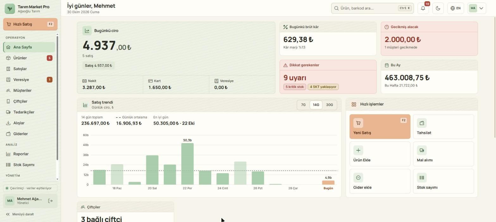
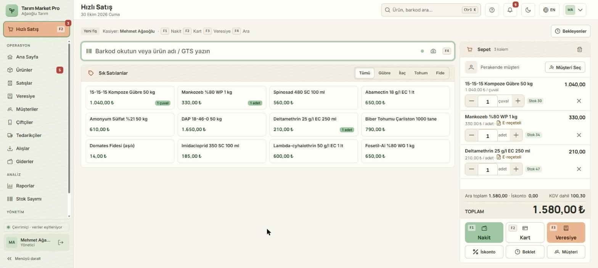
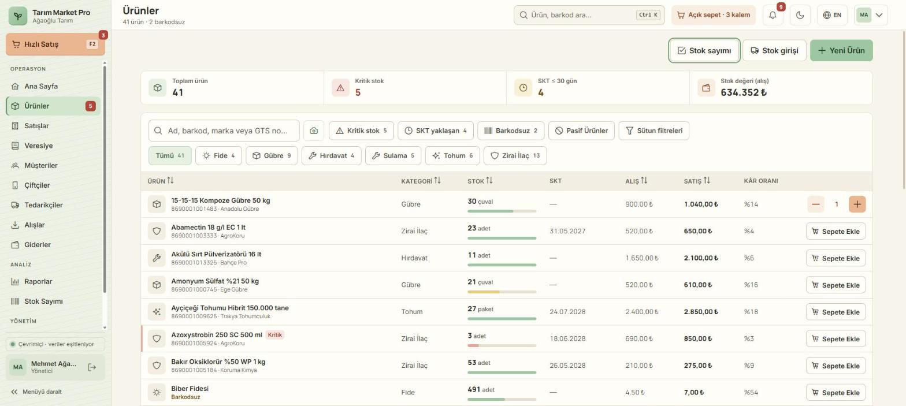
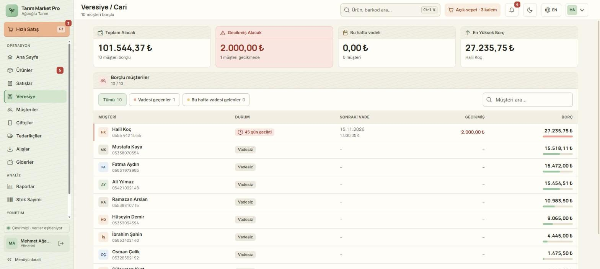
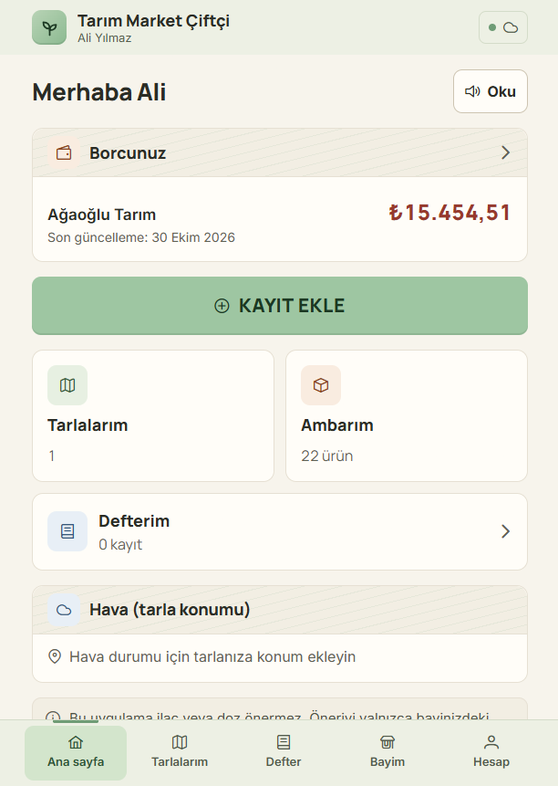

# Tarım Market Pro

[](https://github.com/furkan0rhan/agaoglu/actions/workflows/windows-release.yml)
[](https://github.com/furkan0rhan/agaoglu/actions/workflows/android-build.yml)

Zirai ilaç, gübre, tohum ve fide bayileri için satış (POS), stok, veresiye ve mevzuat takip uygulaması.
Windows masaüstü (exe/msi), Android (apk) ve web'de aynı kod tabanıyla çalışır; bayinin çiftçileri için
ayrı bir çiftçi modülü ve platform yönetimi için superadmin paneli içerir.

| Ana sayfa | Hızlı satış (POS) |
|---|---|
|  |  |
| **Ürünler** | **Veresiye / Cari** |
|  |  |



## Özellikler

**Bayi**
- **POS:** barkod/karekod ile hızlı satış, F tuşları, ondalık miktar ve birimler, iskonto, satış bekletme, nakit/kart/veresiye ve karışık ödeme, 58/80 mm fiş.
- **Stok:** parti ve SKT takibi (FEFO), GTS/karekod birim takibi, kritik stok ve SKT uyarıları, stok sayımı, stok hareketleri — ayrıntı: [docs/GTS-KAREKOD.md](docs/GTS-KAREKOD.md).
- **Veresiye:** vade, taksit takvimi, peşinat, hasatta ödeme, gecikmiş alacaklar, ekstre PDF, WhatsApp/SMS hatırlatma.
- **Mevzuat:** e-reçete kaydı, ruhsat ve etken madde bilgisi, satışta GTS kaydı, SKT'si geçmiş ürün engeli, KVKK rızası ve TC maskeleme.
- **Alış ve tedarikçi:** alış faturası/irsaliye, tedarikçi cari hesabı ve ödemeler.
- **Raporlar:** ciro, brüt kâr, kasa özeti, en çok satanlar, kategori; Excel/PDF dışa aktarma.
- **Ekip ve roller:** yönetici / kasiyer / personel, e-posta davetiyle katılım.
- **Yedek:** tüm verinin JSON/Excel yedeği ve boş işletmeye geri yükleme.
- **Kamera ile barkod/karekod okuma** (web/masaüstü ve Android), GS1 karekoddan SKT ve parti no.
- **Çevrimdışı çalışma:** Firestore kalıcı önbelleği; bağlantı gelince otomatik eşitleme.
- Türkçe/İngilizce arayüz, açık/koyu tema.

**Çiftçi modülü** (`/ciftci`) — bayi davetiyle giriş; tarlalar ve sezonlar, ilaçlama defteri ve hasat aralığı (PHI), ambar,
bayiye borç, bayi önerileri, hava durumu. Ayrıntı: [docs/CIFTCI-MODULU.md](docs/CIFTCI-MODULU.md).

**Superadmin** — işletme listesi, lisans (plan, süre, kullanıcı sınırı), destek modu ve erişim kaydı.
Ayrıntı: [docs/SUPERADMIN.md](docs/SUPERADMIN.md).

## Teknoloji

Angular 21 (standalone, signals, NgRx Signals) · PrimeNG 21 · Tailwind CSS 3 · Firebase (Auth + Firestore, Spark planı) ·
Tauri 2 (Windows + Android) · ZXing · Chart.js · jsPDF · SheetJS · Vitest · ESLint.

## Hızlı başlangıç

Gerekenler: Node.js 22+, npm. (Masaüstü paketi için ayrıca Rust ve Tauri önkoşulları.)

```bash
npm ci --legacy-peer-deps   # @angular/fire 20 ile Angular 21 peer uyumsuzluğu nedeniyle
npm start                   # http://localhost:4200 (canlı Firebase projesine bağlanır)
npm run tauri:dev           # masaüstü uygulaması olarak
```

## Yerel test ortamı (Firebase Emulator)

Canlı veriye dokunmadan demo veriyle çalışmak için (ayrıntı: [docs/TEST-ORTAMI.md](docs/TEST-ORTAMI.md)):

```bash
npm run emu        # Terminal 1: Auth + Firestore emulator (veri .emulator-data içinde saklanır)
npm run emu:seed   # Terminal 2: demo verisi ve test hesapları (bir kez)
npm run dev:emu    # Terminal 2: uygulama emulator'e bağlı, http://localhost:4200
```

Test hesapları (şifre hepsinde `Test1234!`): `admin@test.local` (bayi sahibi), `kasiyer@test.local`,
`personel@test.local`, `admin2@test.local` (ikinci bayi), `super@test.local` (superadmin), `ciftci@test.local` (çiftçi).

## Testler

```bash
npm test             # birim testleri (Vitest, ng test)
npm run test:rules   # Firestore güvenlik kuralı testleri (emulator'ü kendisi başlatır)
npm run lint         # ESLint
```

## Sürüm çıkarma (exe / apk)

```bash
npm run release -- 1.2.0
```

Script sürüm numarasını `package.json`, `tauri.conf.json` ve `Cargo.toml`'a yazar, commit + etiket oluşturup gönderir.
Etiketle GitHub Actions Windows (exe/msi) ve Android (apk/aab) derlemelerini başlatır; dosyalar taslak bir
**GitHub Release**'e eklenir, kontrol edip yayınlarsınız. Android imzalama ve kurulum: [docs/APK.md](docs/APK.md).

### Windows otomatik güncelleme (v1.3.0+)

Kurulu EXE'ler `https://github.com/furkan0rhan/agaoglu/releases/latest/download/latest.json` adresini denetler
(açılıştan birkaç saniye sonra ve birkaç saatte bir). Yeni sürüm varsa sağ altta "Şimdi güncelle / Sonra" çıkar;
POS sepeti doluyken kurulum önerilmez. Güncellemeler Tauri updater imzasıyla doğrulanır.

- **Bir kez yapılacak:** GitHub → repo → *Settings → Secrets and variables → Actions → New repository secret*:
  - `TAURI_SIGNING_PRIVATE_KEY` — `.keys/tauri-updater.key` dosyasının tüm içeriği
  - `TAURI_SIGNING_PRIVATE_KEY_PASSWORD` — `.keys/tauri-updater-password.txt` içeriği

  Secret'lar yoksa derleme yine başarılı olur ama `latest.json`/`.sig` üretilmez (Actions'ta uyarı görünür)
  ve o sürüm otomatik güncellemeyle dağıtılmaz.
- **Güncelleme ancak "Publish" ile yayılır:** taslak (draft) ve pre-release sürümler "latest" sayılmaz.
- **1.3.0'dan eski sürümler** (1.2.0 ve öncesi) güncelleyiciyi içermez: bayilerdeki bilgisayarlara 1.3.0
  **bir kez elle** kurulmalı. Sonrası otomatiktir.
- Özel anahtar kaybolursa kurulu uygulamalar yeni sürümü kabul etmez; yeni anahtarla çıkan sürüm yine bir kez elle
  kurulmalıdır. `.keys/` klasörünü yedekleyin (gitignore'da, asla commit etmeyin).
- Bayiye verilecek tek sayfalık kurulum rehberi: [docs/KURULUM-BAYI.md](docs/KURULUM-BAYI.md).

## Firebase deploy

Kurallar ve indeksler (canlıya yüklemeden önce `firestore.rules.md` kontrol listesine bakın):

```bash
firebase deploy --only firestore:rules,firestore:indexes
```

## Klasör yapısı

```
src/app/core/        kimlik doğrulama, i18n, lisans, ayarlar, tema, bildirimler, ürün turu
src/app/features/    ekranlar: pos, products, credit, customers, purchases, suppliers, reports, farmer, admin …
src/app/layout/      uygulama kabuğu (kenar çubuğu, üst çubuk, mobil menü)
src/app/shared/      ortak UI bileşenleri, modeller, barkod/karekod okuyucu, yardımcılar
src-tauri/           Tauri (Rust) masaüstü ve Android projesi
tests/rules/         Firestore kural testleri
scripts/             sürüm, emulator ve yardımcı script'ler
docs/                rehberler, tasarım prototipleri, marka dosyaları, ekran görüntüleri
```

## Dokümanlar

| Dosya | İçerik |
|---|---|
| [TASKS.md](TASKS.md) | Görev listesi ve proje durumu |
| [CHANGELOG.md](CHANGELOG.md) | Sürüm geçmişi |
| [docs/TEST-ORTAMI.md](docs/TEST-ORTAMI.md) | Emulator ile yerel test ortamı, demo veri, test hesapları |
| [docs/APK.md](docs/APK.md) | Android derleme, imzalama, kurulum |
| [docs/KURULUM-BAYI.md](docs/KURULUM-BAYI.md) | Bayi için Windows kurulum ve güncelleme rehberi (tek sayfa) |
| [docs/SUPERADMIN.md](docs/SUPERADMIN.md) | Superadmin, destek modu, lisans |
| [docs/CIFTCI-MODULU.md](docs/CIFTCI-MODULU.md) | Çiftçi modülü tasarımı |
| [docs/GTS-KAREKOD.md](docs/GTS-KAREKOD.md) | Ürünler ve GTS/karekod takibi |
| [docs/MUSTERI-TEST-RAPORU.md](docs/MUSTERI-TEST-RAPORU.md) | Müşteri gözüyle test bulguları |
| [firestore.rules.md](firestore.rules.md) | Güvenlik kuralları açıklaması ve deploy kontrol listesi |
| [src/app/shared/ui/README.md](src/app/shared/ui/README.md) | Ortak UI bileşenleri ve tasarım tokenları |
| `docs/design/` | Seçilen tasarım prototipi (`c-saha-komuta`), renk seçenekleri; reddedilenler `arsiv/` altında |

## Lisans

© Tüm hakları saklıdır. Ticari üründür; izinsiz kopyalanamaz, dağıtılamaz.
<!-- TODO: lisans metni ürün sahibiyle netleştirilecek. -->
